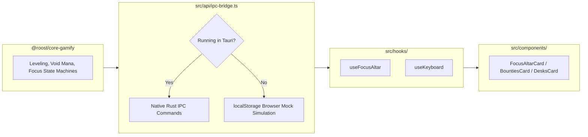

# Frontend Cockpit Architecture & Component Guide (`apps/desktop/src`)

> **For the UI/UX Collaborator**: This guide explains how the frontend is structured, how data flows, and how you can freely redesign, restyle, or recreate components without worrying about breaking backend logic.

---

## 1. Directory Tree & Path Conventions

```text
apps/desktop/src/
├── api/
│   └── ipc-bridge.ts          # Dual-Mode IPC Client Bridge (Tauri IPC vs. Browser Mock)
├── audio/
│   └── sound-fx.ts            # Procedural Web Audio Synthesizer (clicks, chimes, fanfares)
├── components/                # Modular, Decoupled UI Bento Cards & Modals
│   ├── BountiesCard.tsx       # Today's 3 Bounties with j/k keyboard selection & XP rewards
│   ├── DesksCard.tsx          # The Three Desks (University, Work, Personal) & attributes
│   ├── FocusAltarCard.tsx     # High-Immersion Focus Altar (25/50/90m timers & Void Mana)
│   ├── HabitsCard.tsx         # Daily Habit rituals & Sanctuary Rest streak freeze
│   ├── HeaderDeck.tsx         # Top Astrolabe logo, Crow Rank, Level meter, Mana status
│   ├── KeyboardCheatSheet.tsx # Shortcut cheat sheet modal (summoned with '?')
│   ├── QuickCaptureModal.tsx  # Fast note creation palette (summoned with 'n' or 'Ctrl+K')
│   └── RecentFilesCard.tsx    # Live Obsidian vault note explorer with direct URI links
├── hooks/                     # Pure Business Logic & State Decoupling Hooks
│   ├── use-focus-altar.ts     # Timer intervals, ticking, pause/resume, and audio cues
│   └── use-keyboard.ts        # Global home-row hybrid keyboard engine (j/k, Space, g u/o/p)
├── App.tsx                    # Root Sanctum Cockpit Coordinator & Bento Grid Layout
├── index.css                  # Design Tokens, CSS variables, orbital animations
└── main.tsx                   # Vite / React 19 entry point
```

---

## 2. Decoupled Architecture (How to Recreate UI Safely)

We follow a strict **Separation of Concerns**:
- **Hooks & Bridge hold the Logic**: All timer intervals, IPC invocations, localStorage fallbacks, and state mutations live in `hooks/` and `api/`.
- **Components are Pure Presentational Shells**: Every card in `components/` merely takes props or calls a clean hook.

### Example: Customizing the Focus Altar (`FocusAltarCard.tsx`)
If you want to completely restyle the Focus Altar (e.g. from linear bars to a circular SVG ring or a minimalist countdown):
1. Keep the hook call:
   ```typescript
   const {
     session,
     isFocusing,
     isPaused,
     timeRemainingFormatted,
     progressPercent,
     startSession,
     pauseSession,
     resumeSession,
     completeSession,
     abandonSession,
   } = useFocusAltar({ onSessionCompleted, onSessionAbandoned });
   ```
2. You can rewrite the entire return JSX! The timer will continue ticking, audio will continue chiming, and Void Mana will continue syncing with zero regressions.

---

## 3. Data Flow



---

## 4. Design Tokens & CSS Variables

All tokens are defined in [`src/index.css`](./index.css):

| CSS Variable | Hex / Value | Usage |
| :--- | :--- | :--- |
| `--void-dark` | `#07080B` | Main window background |
| `--void-card` | `#13161F` | Bento cards, dialogue modals |
| `--stone-border` | `#222738` | Card borders, dividers |
| `--gold-primary` | `#C9A962` | Astrolabe Gold, active rings, progress bars |
| `--gold-light` | `#DFCA8F` | Accent highlights, level badges |
| `--ash-light` | `#E1E4EA` | Primary headings and text |
| `--ash-muted` | `#8E95A5` | Secondary text, shortcut tags |

### Predefined Utility Classes
- `.stone-card`: Applies the solid slate background, subtle border, rounded corners (`1.25rem`), and soft atmospheric drop-shadow.
- `.orbit-slow` & `.orbit-counter`: Drives the celestial astrolabe logo rotation in `HeaderDeck.tsx`.

---

## 5. Keyboard Navigation Engine

Every card should expose keyboard interactions:
- In `hooks/use-keyboard.ts`, keys are listened to globally unless the user is focused inside an `<input>` or `<textarea>`.
- Available bindings:
  - `j` / `k` (or `↓` / `↑`): Traverse selectable items.
  - `Space`: Toggle item completion.
  - `n` or `Ctrl+K`: Open Quick Capture palette.
  - `g u`, `g o`, `g p`: Jump to Academic, Commercial, or Personal desks.
  - `?`: Toggle keyboard cheat sheet.
  - `Esc`: Dismiss any modal or dialog.

---

## 6. Procedural Audio Synthesizer

Located in [`src/audio/sound-fx.ts`](./audio/sound-fx.ts). Uses the Web Audio API with zero external asset files:
- `playMechanicalClick()`: Subtly clicks when navigating lists.
- `playCelestialChime()`: C-major chime when completing tasks.
- `playLevelUpFanfare()`: Multi-tone harmonic progression on leveling up.
- `toggleAudio()`: Toggles sound on/off and returns current boolean state.
