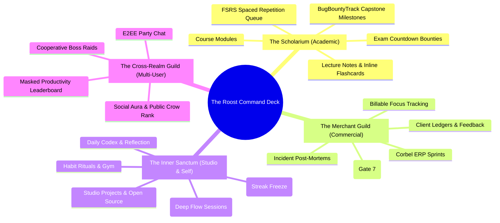

# Business Requirements Document (BRD)
## Project: The Roost Command Deck
*A Bespoke Gamified Life Operating System & Decoupled Cross-Platform Ecosystem for The Fallen Crow*

**Document ID**: `BRD-ROOST-001`  
**System**: Crow Parliament  
**Lead Author**: Victoria Vance — The Quill (`VANCE-REQ`) | Gate 1 Lead (DoR)  
**Stakeholder & Product Owner**: Taha Asadullah (The Foolish Crow)  
**Systems Architect**: Arthur Pendleton (`PENDELTON-ARCH`) | Gate 2 Lead (DoAC)  
**Security Lead**: Cyra Kaelen (`KAELEN-SEC`) | Gate 5 Lead (DoSA)  
**Date**: October 9, 2026  
**Status**: Certified Baseline (Gate 1: Definition of Ready)  

---

## 1. Executive Summary & Vision

### 1.1 The Inspiration & The Problem
Knowledge workers, software students, and creators who live their entire day behind a laptop screen (Uni $\rightarrow$ Work $\rightarrow$ Home) face profound organizational friction and mental exhaustion:
1. **The Friction of "Mouse-Heavy" Disorganization**: People who *prefer* to be organized often fail to stay organized because standard tools (Notion, ClickUp, complex Obsidian setups) demand endless mouse clicks, folder navigation, dropdown hunting, and manual formatting. Taking your hands off the keyboard interrupts flow, leading to messy desktops and abandoned systems.
2. **The Isolation & Frustration of Learning Alone**: Sitting in front of a laptop for 12 hours a day studying abstract CS concepts or debugging code in isolation leads to cognitive blocks, frustration, and procrastination when hitting a wall.
3. **Superficial "Production Factory" Software**: Most productivity tools feel like corporate office cubicles (Jira tickets, velocity KPIs, guilt-inducing streak resets), treating human beings like assembly lines rather than providing a cozy, empowering personal space.

### 1.2 The Solution: The Digital Sanctuary
**The Roost Command Deck** is a production-grade, everyday life operating system designed as an empowering **Digital Sanctuary & Command Base** under the dark celestial aesthetic of *The Fallen Crow*:
- **Hybrid Keyboard Speed (Zero Mouse Mandate)**: Combining instant Vim-style single-key shortcuts (`j/k`, `Space`, `n`, `f`, `g u/o/p`) with a fuzzy Command Palette (`Ctrl+K`) so capturing a thought or switching contexts takes $< 2$ keystrokes from the home row.
- **The Three Desks**: A personal **Sanctum** for daily life & habits, an **Academic Desk** for uni courses and lecture notes, and a **Work Desk** for commercial projects.
- **The Guild Tavern (The Anti-Isolation Co-Working Room)**: A cozy virtual room where friends can study together with shared timers, ask for help when stuck, hang out, and play a quick game of **Chess** during study breaks to reset their minds.
- **Intrinsic RPG Life Progression**: Real-world character growth across three tangible life attributes: **Intellect**, **Craft**, and **Vitality**, with "Sanctuary Rest" mechanics that recognize that human recovery is part of growth.

### 1.3 Dual-Target Product Strategy
To support both daily personal sovereignty and commercial viability, the system is designed around a unified core backend powering two distinct editions:
1. **Edition A: Sanctum Sovereign (Studio, Friends & Company Edition)**:
   - Tailored for Taha Asadullah, close friends, and studio/company use.
   - Deep native coupling to Taha's local Obsidian vault (`TheFallenCrow`) and arbitrary POSIX filesystem directories.
   - Private peer-to-peer / Guild Tavern with encrypted session state, live focus sync, and Chess study breaks.
   - 100% sovereign data; zero cloud tracking.
2. **Edition B: Commercial Prototype (Showcase & Product/SaaS Edition)**:
   - Packaged as a sellable prototype or commercial desktop/web app.
   - Modular decoupled storage adapter (mock/sandbox, configurable directory, or cloud-ready storage).
   - Pre-populated showcase demo profiles (CS Student, Studio Developer, Freelancer).
   - Clean distribution without private studio file paths or personal notes.

---

## 2. Stakeholder Persona & Operating Context

### 2.1 Primary Persona: The Keyboard-First Builder
- **Profile**: Software student and studio developer living an intensive laptop-centric life, seeking effortless order without high-friction manual maintenance.
- **Behavior**: Prefers keyboard navigation, hates unnecessary mouse clicks, wants tools to organize files *for* him, and values community co-working with friends to avoid burnout.
- **Aesthetic Standard**: Anti-slop visual ergonomics: generous organic curvature (`24px-28px`), atmospheric elevation (`#07080B` Void Obsidian, `#13161F` Stone Plate, `#C9A962` Astrolabe Gold), kinetic micro-springs, and tactile procedural Web Audio synthesis.

---

## 3. High-Level Scope & Three Sovereign Realms

The application partitions daily life into three strictly decoupled domains, each with customized workflows, file taxonomies, and progression incentives:

---

## 4. Agile Contract-First FDD & Collaboration Model

We adopt an **Agile Feature-Driven Development (FDD)** and **Contract-First Living Documentation** workflow:
- **Backend & Verification Lead (Alexander Cross / Antigravity)**: Focuses exclusively on feature-by-feature backend construction, Rust native systems, type-safe domain logic, and automated test suites.
- **Frontend & UI/UX Collaborator**: Implements UI/UX and visual ergonomics in React 19 / Tailwind without waiting on ad-hoc meetings.
- **Living Documentation Standard**: After each backend change, we publish crystal-clear, self-explanatory IPC/API contracts (`docs/CONTRACTS.md`) and implementation notes so the collaborator can plug in UI components seamlessly.

| Feature ID | Feature Name | Core Outcome | Deliverable Package |
| :--- | :--- | :--- | :--- |
| **FEAT-01** | **Core Cockpit & Native OS File Engine** | Working desktop window, dark celestial bento layout, XP/Rank engine, and native Rust command creating `.md` files with YAML frontmatter anywhere on the OS. | `apps/desktop` + `@roost/core-gamify` + `@roost/fs-engine` |
| **FEAT-02** | **High-Immersion Focus Altar & Mana Engine** | Distraction-free full-screen Focus shield, ambient binaural void synthesizer, 25/50m timers, Void Mana burn/recharge, and deep work logs. | `@roost/modes` (Focus) + Web Audio |
| **FEAT-03** | **Learning Mode & Automated FSRS Spaced Repetition** | Inline flashcard parsing (`Q::A` / `==Cloze==`) from markdown lecture notes, FSRS-4.5 scheduling engine, and active-recall review deck. | `@roost/modes` (Learn) + Markdown Parser |
| **FEAT-04** | **Hybrid Note Editor & Bidirectional Knowledge Graph** | Markdown-first editor (TipTap/CodeMirror) with live visual blocks, `[[wikilinks]]`, tag explorer, and 100% Obsidian interoperability. | `@roost/notes-editor` |
| **FEAT-05** | **Zero-Knowledge Guild Network & Cooperative Boss Raids** | Multi-user WebSocket relay, E2EE party chat, shared Boss Raid health pools, and masked privacy telemetry firewalls. | `@roost/guild-network` + `apps/relay-server` |
| **FEAT-06** | **Mobile Companion View** | Agile mobile companion shell (Tauri Mobile / PWA) for FSRS card review, quest checking, habit logging, and guild chat. | `apps/companion` |

---

## 5. Business & Operational Success Metrics (KPIs)

1. **Local File Integrity**: 100% of created and edited notes must persist as valid standard Markdown (`.md`) with valid YAML frontmatter, readable by Obsidian, Neovim, and VS Code with zero data corruption.
2. **Zero Privacy Leakage**: Automated contract audits must verify that exactly 0 bytes of private note bodies, filenames, or directory paths are ever transmitted over the network.
3. **Execution Latency**:
   - Quick-capture file creation (`Ctrl+K`): < 100ms from keystroke to disk write.
   - UI launch time: < 1.5 seconds on Linux desktop.
   - Spaced repetition card flip: 60fps / 0ms perceived lag.
4. **Sustained Habit Consistency**: Daily consistency streak calculation with "Sanctuary Rest" protection, achieving zero unfair streak loss during planned recovery days.

---
*Signed by Victoria Vance (`VANCE-REQ`) & Arthur Pendleton (`PENDELTON-ARCH`), for Taha Asadullah / The Foolish Crow.*
