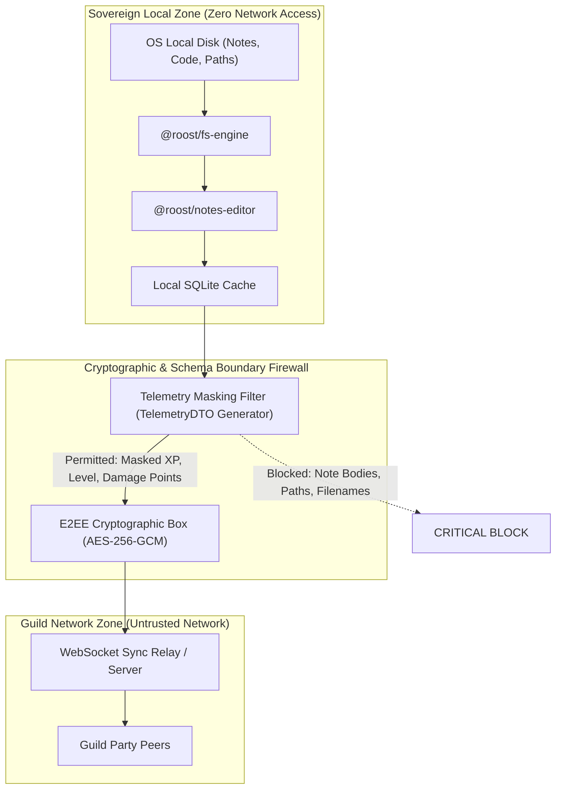

# Guild & Multi-User Privacy Implications Report
*Architectural Data Boundaries, Threat Modeling, and Sovereignty Invariants for The Roost Command Deck*

**Document ID**: `REQ-PRIV-ROOST-001`  
**System**: Crow Parliament  
**Lead Author**: Victoria Vance — The Quill (`VANCE-REQ`) | Gate 1 Lead (DoR)  
**Security Reviewer**: Cyra Kaelen — The Warden (`KAELEN-SEC`) | Gate 5 Lead (DoSA)  
**Architectural Approver**: Arthur Pendleton — The Architect (`PENDELTON-ARCH`) | Gate 2 Lead (DoAC)  
**Date**: October 9, 2026  
**Status**: Formal Architectural Specification Baseline  

---

## 1. Executive Summary & Problem Context

When personal life management (University courses, commercial client work, personal journals) is integrated with social gamification (Multi-User Guilds, Party Raids, Shared Leaderboards), **unbounded data sharing creates catastrophic privacy and security risks**:
1. Leaking commercial client details (e.g., Corbel ERP customer names or proprietary invoice data) into guild chat or party leaderboards.
2. Leaking academic integrity data (e.g., unsubmitted capstone drafts or exam study notes) to peer students.
3. Exposing OS filesystem directory structures, usernames, or absolute paths across network sockets.

To eliminate these risks by design, **The Roost Command Deck establishes an unbreachable Zero-Knowledge Privacy Boundary**: your personal filesystem, notes, journals, and local paths are **100% sovereign and strictly local**. Only sanitized, masked game telemetry (Crow Rank, Level, Boss damage points, and end-to-end encrypted chat) crosses the network boundary into the Guild system.

---

## 2. Three-Tier Data Taxonomy & Classification Matrix

Every piece of data processed within the application is strictly partitioned into one of three isolated classification tiers:

| Data Element | Tier Classification | Storage Location | Network Transmission | Guild Visibility |
| :--- | :--- | :--- | :--- | :--- |
| **Note Content & Markdown AST** | **Tier 1: Sovereign Local** | Local OS Disk (`.md` / SQLite) | **NEVER** (Blocked by kernel) | None |
| **Absolute File Paths & Directories** | **Tier 1: Sovereign Local** | Local Memory / Config | **NEVER** | None |
| **Personal Journal & Mindset Logs** | **Tier 1: Sovereign Local** | Local OS Disk | **NEVER** | None |
| **Course Codes & Client Names** | **Tier 1: Sovereign Local** | Local Frontmatter | **NEVER** | None |
| **Raw Search Queries & FTS Index** | **Tier 1: Sovereign Local** | Local SQLite / Memory | **NEVER** | None |
| **Focus Time Duration (e.g. 90m)** | **Tier 2: Masked Telemetry** | Local + Sync Cache | Opt-in Broadcast | Numeric only (no project title) |
| **Bounties Completed Count (e.g. 4)** | **Tier 2: Masked Telemetry** | Local + Sync Cache | Opt-in Broadcast | Count only (titles masked) |
| **Crow Rank & Player Level** | **Tier 3: Public Telemetry** | Local + Guild Server | Public to Guild | Visible |
| **Boss Raid Damage Points** | **Tier 3: Public Telemetry** | Local + Guild Server | Public to Guild | Visible |
| **Presence Status ("In Focus Altar")** | **Tier 3: Public Telemetry** | Real-time WebSocket | Ephemeral Broadcast | Status enum only |
| **Party Chat Messages** | **Tier 3: Public Telemetry** | Encrypted Relay | End-to-End Encrypted (AES-GCM) | Party members only |

---

## 3. STRIDE Threat Model & Mitigations (Cyra Kaelen)



### Threat 1: Information Disclosure via Metadata Leakage
* **Threat**: A user completes a quest titled *"Corbel ERP Fix SQLite FTS5 Bug"*. If the quest title is synchronized to the Guild leaderboard, confidential commercial client details are leaked to other guild members.
* **Mitigation**: The `@roost/core-gamify` engine decouples the quest's **semantic label** (local only) from its **game contribution** (public). The network payload sends only:
  ```json
  {
    "userId": "usr_c4f82",
    "event": "BOUNTY_COMPLETED",
    "xpEarned": 75,
    "manaConsumed": 20,
    "timestamp": "2026-10-09T00:15:00Z"
  }
  ```
  The quest title, note path, and category remain locked inside the local machine.

### Threat 2: Path Traversal & OS Structure Reconnaissance
* **Threat**: Guild synchronization protocol accidentally sends local file URI paths (`file:///home/user/...`) causing device identification, username harvesting, or path traversal attacks.
* **Mitigation**: The Guild Network adapter has zero access to the filesystem module. In the monorepo, `@roost/guild-network` has **zero dependency** on `@roost/fs-engine`. An automated lint rule asserts that `@roost/guild-network` cannot import from filesystem packages.

### Threat 3: Eavesdropping on Guild Communications
* **Threat**: A compromised WebSocket relay server inspects private guild party communications.
* **Mitigation**: Guild chat rooms use client-side AES-256-GCM authenticated encryption. The relay server acts solely as an opaque packet router unable to decrypt party messages.

---

## 4. Formal INVEST User Stories (Victoria Vance)

### Story 1: Sovereign Note Isolation (REQ-PRIV-01)
* **As a** privacy-conscious engineer working on confidential academic and commercial projects,
* **I want** my notes, markdown files, and filesystem paths to remain strictly confined to my local machine,
* **So that** no external party, guild member, or remote server can ever access my personal thoughts or proprietary work.
* **Acceptance Criteria (Gherkin)**:
  ```gherkin
  Scenario: Creating and editing a private note
    Given the user has created a note in the "Commercial" realm
    When the note is saved to the local disk
    Then no HTTP request containing note content or file path is dispatched
    And the Guild network adapter logs zero outbound bytes for the note event
  ```

### Story 2: Masked Cooperative Boss Raid Contribution (REQ-PRIV-02)
* **As a** Guild member fighting a cooperative Boss Raid (e.g. "End-of-Term Final Defense"),
* **I want** to contribute damage to the shared boss pool by completing my local focus sessions,
* **So that** my guild sees my contribution without seeing what specific task I worked on.
* **Acceptance Criteria (Gherkin)**:
  ```gherkin
  Scenario: Reporting Boss Raid damage to guild
    Given the user completes a 50-minute Focus session on a private assignment
    When the session finishes successfully
    Then the local engine awards 150 damage points to the Boss
    And the outbound Guild packet contains only { damage: 150, partyId: "party_01" }
    And the packet contains zero assignment titles, filenames, or directory paths
  ```

---

## 5. Architectural Recommendations & Regulatory Compliance

1. **Privacy-by-Design Default**: All social/guild sharing is strictly **Opt-In**. A user can run the entire command deck in 100% offline solo mode indefinitely.
2. **Local Key Derivation**: Guild encryption keys are generated locally on the device using Web Crypto / Rust `ring` and never stored unencrypted on remote relays.
3. **Auditability**: A dedicated **Privacy Inspector Modal** in the settings shows the user the exact JSON payload of the last 20 network packets sent to the guild server, providing complete empirical transparency.

---
*Signed by Victoria Vance (`VANCE-REQ`) & Cyra Kaelen (`KAELEN-SEC`), for Taha Asadullah / The Foolish Crow.*
