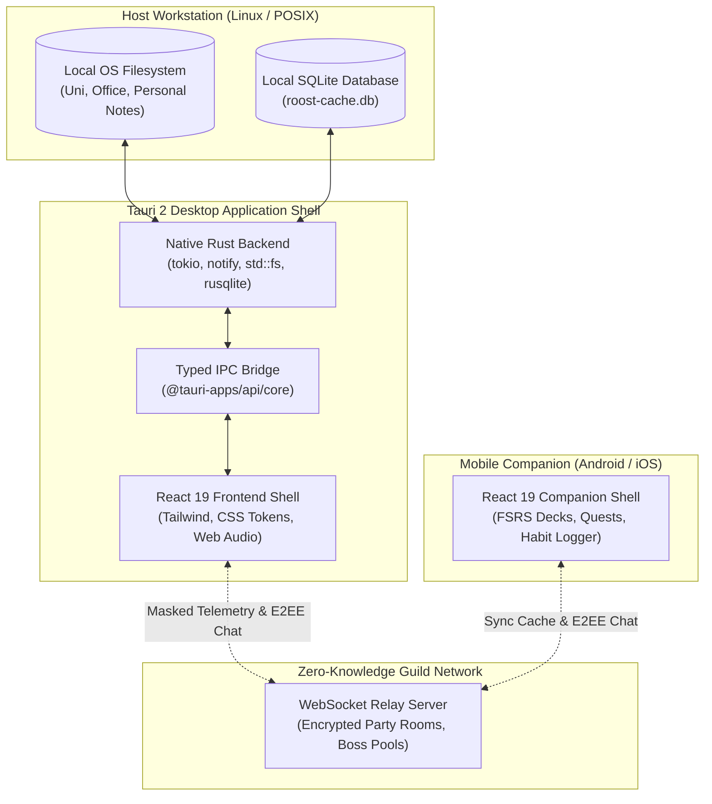

# Software Requirements Specification (SRS)
## Project: The Roost Command Deck
*IEEE 830 / ISO/IEC/IEEE 29148 Standard Compliant Specification*

**Document ID**: `SRS-ROOST-001`  
**System**: Crow Parliament  
**Lead Author**: Victoria Vance — The Quill (`VANCE-REQ`) | Gate 1 Lead (DoR)  
**Governing Authority**: Taha Asadullah (The Foolish Crow)  
**Systems Architect**: Arthur Pendleton (`PENDELTON-ARCH`) | Gate 2 Lead (DoAC)  
**Security Lead**: Cyra Kaelen (`KAELEN-SEC`) | Gate 5 Lead (DoSA)  
**QA Lead**: Elena Rostova (`ROSTOVA-QA`) | Gate 4 Lead (DoQV)  
**Date**: October 9, 2026  
**Status**: Certified Baseline (Gate 1: Definition of Ready)  

---

## 1. Introduction

### 1.1 Purpose
This Software Requirements Specification (SRS) establishes the definitive functional, architectural, interface, and non-functional requirements for **The Roost Command Deck** (`roost-deck`), a sovereign, gamified cross-platform life engine designed for Taha Asadullah across University, Office, and Personal realms.

### 1.2 Scope & Target Editions
The system encompasses a unified modular backend driving two distinct runtime editions:
1. **Edition A (Sanctum Sovereign)**: For personal, studio, and friend co-working. Direct local Obsidian vault coupling (`TheFallenCrow`), local POSIX filesystem operations, zero-knowledge P2P Guild Tavern with integrated Chess study breaks.
2. **Edition B (Commercial Prototype)**: For product demonstrations, commercial licensing, or SaaS deployment. Decoupled storage adapters (mock/sandbox or cloud storage), pre-populated showcase profiles, and clean standalone operation.

The development follows an **Agile Contract-First FDD Model**:
- **Backend & Core Systems**: Constructing type-safe Rust backend services, core TypeScript domain packages, SQLite/Markdown storage engines, and automated test coverage.
- **Frontend & UI/UX Collaborator**: Implementing user interfaces against explicit, self-explanatory IPC/API contracts (`docs/CONTRACTS.md`).

### 1.3 Definitions, Acronyms, and Abbreviations
- **AST**: Abstract Syntax Tree.
- **DoR**: Definition of Ready (Gate 1 milestone certification).
- **FDD**: Feature-Driven Development.
- **FSRS**: Free Spaced Repetition Scheduler (state-of-the-art DSR memory model).
- **IPC**: Inter-Process Communication (Tauri frontend-to-Rust bridge).
- **OPFS**: Origin Private File System (Web browser filesystem API).
- **POSIX**: Portable Operating System Interface (Linux/macOS filesystem standards).
- **STRIDE**: Security threat classification (Spoofing, Tampering, Repudiation, Information Disclosure, DoS, Elevation of Privilege).

---

## 2. Overall System Description

### 2.1 Product Perspective & Context
The Roost Command Deck operates directly within Taha's primary computing environment (*The Roost*), managing files across arbitrary directories (e.g., Obsidian vaults, documents, code repositories) while preserving strict local sovereignty.

### 2.2 User Characteristics
- **Sole Primary Operator**: Taha Asadullah (Technical Lead, Student Engineer).
- **Peer Guild Members**: Trusted engineering colleagues participating in cooperative boss raids and party channels.

### 2.3 General Constraints
- **Zero Cloud Lock-in**: All core functionality (file management, notes, flashcards, quest progression, leveling) must function 100% offline without network connectivity.
- **Pure Markdown Ground Truth**: Notes must remain standard Markdown (`.md`) with valid YAML frontmatter, ensuring zero corruption when opened in Obsidian, VS Code, or Neovim.
- **Zero Privacy Leakage**: Note bodies, local file paths, and personal directory structures are structurally forbidden from transmission over network sockets.

---

## 3. Functional Requirements (By FDD Domain)

### Domain 1: Core Gamification Engine (`@roost/core-gamify`)
* **REQ-FR-001 (Deterministic XP Curve)**: The engine shall calculate the required XP for any level $L$ using the formula $XP_{\text{needed}}(L) = \lfloor 120 \times L^{1.45} \rfloor$.
* **REQ-FR-002 (Crow Rank State Machine)**: The system shall transition player titles based on level boundaries:
  - Levels 1–4: *Fledgling Crow*
  - Levels 5–9: *Novice of the Roost*
  - Levels 10–19: *Raven Watcher*
  - Levels 20–34: *Obsidian Alchemist*
  - Levels 35–49: *Master of the Three Legs*
  - Level 50+: *Grand Sovereign Architect*
* **REQ-FR-003 (Void Mana Pool)**: The system shall maintain a Void Mana pool (0–100). Mana shall deplete by 20 points per 25-minute focus session and regenerate by 10 points per 15 minutes of deliberate rest.
* **REQ-FR-004 (Streak & Sanctuary Freeze)**: The system shall increment the Daily Consistency Streak upon completing at least one daily ritual before midnight. The system shall provide an explicit "Sanctuary Rest" toggle that freezes the streak for up to 48 hours without penalty.
* **REQ-FR-005 (Quest State Lifecycle)**: Quests shall transition through deterministic states: `Draft` $\rightarrow$ `Active` $\rightarrow$ `In-Progress` $\rightarrow$ `Completed` $\rightarrow$ `Archived`. Completing a quest shall atomically award its configured XP bounty.

---

### Domain 2: Native OS Filesystem Engine (`@roost/fs-engine`)
* **REQ-FR-006 (Arbitrary POSIX File Operations)**: The Rust backend shall execute atomic file write, read, move, and directory creation anywhere on the host filesystem where the user has OS permissions.
* **REQ-FR-007 (Path Traversal & Symlink Defense)**: The engine shall canonicalize all target paths and reject traversal attacks (`../`, illegal escape sequences) attempting to write outside user-authorized workspace roots.
* **REQ-FR-008 (Quick-Capture Modal `Ctrl+K`)**: The frontend shall provide a global keyboard shortcut (`Ctrl+K` / `Cmd+K`) opening a quick-capture palette that accepts a note title, realm selection, and template, and writes the `.md` file to disk within 100ms.
* **REQ-FR-009 (Standard YAML Frontmatter Injection)**: Every generated file shall contain standardized YAML frontmatter including `title`, `realm`, `type`, `created`, `tags`, `xp_value`, and `status`.
* **REQ-FR-010 (Directory Change Watcher)**: The engine shall use the Rust `notify` crate to detect external filesystem modifications in configured realm folders and refresh file lists in real-time.

---

### Domain 3: High-Immersion Focus Altar (`@roost/modes` Focus)
* **REQ-FR-011 (Distraction-Free Shield)**: Activating Focus Mode shall collapse peripheral navigation and display a full-screen ambient view with timer, active task name, and Void Mana burn rate.
* **REQ-FR-012 (Procedural Audio Synthesizer)**: The system shall use the Web Audio API to generate procedural ambient audio (customizable low-pass void drone, gentle binaural wave, or silent mechanical switch feedback) without external MP3 dependencies.
* **REQ-FR-013 (Flow Session Logging)**: Completing a focus timer (25m or 50m) shall record a session event logging duration, timestamp, and realm without recording private application window titles.

---

### Domain 4: Automated Learning & FSRS Spaced Repetition (`@roost/modes` Learn)
* **REQ-FR-014 (Inline Flashcard Mining)**: The system shall parse Markdown files in the configured University realm and automatically extract:
  - Standard Q&A: `Question Text::Answer Text`
  - Cloze Deletion: `Concept has ==cloze term== embedded`
* **REQ-FR-015 (FSRS-4.5 Algorithm)**: The system shall schedule cards using the Free Spaced Repetition Scheduler algorithm, updating card Difficulty ($D$), Stability ($S$), and Retrievability ($R$) based on user review ratings: *Again (1)*, *Hard (2)*, *Good (3)*, *Easy (4)*.
* **REQ-FR-016 (Daily Due Review Queue)**: The Learning Mode cockpit shall surface the exact count of cards due for review each calendar day and provide a rapid, keyboard-navigable flashcard review deck.

---

### Domain 5: Note System & Knowledge Graph (`@roost/notes-editor`)
* **REQ-FR-017 (Pure Markdown Interoperability)**: The editor shall store notes exclusively as standard UTF-8 Markdown files, ensuring seamless round-trip compatibility with Obsidian, Neovim, and VS Code.
* **REQ-FR-018 (Live Visual Blocks)**: The editor UI shall render headers, code fences, callouts, and interactive checkboxes as tactile visual blocks while retaining plain-text underlying syntax.
* **REQ-FR-019 (Bidirectional `[[Wikilinks]]`)**: The engine shall index `[[Note Title]]` links across realm directories and render a backlink drawer showing all referencing documents.

---

### Domain 6: Zero-Knowledge Guild Network (`@roost/guild-network`)
* **REQ-FR-020 (Telemetry Masking Firewall)**: Outbound telemetry payloads to the Guild relay shall be structurally restricted to the `PublicGuildTelemetryDTO` schema (Player Handle, Crow Rank, Level, Boss Damage, Presence Enum). The firewall shall throw a fatal exception if note bodies, file paths, or private labels are passed.
* **REQ-FR-021 (Client-Side E2EE Party Chat)**: Party chat messages shall be encrypted on the client device using AES-256-GCM before socket transmission. The relay server shall have zero decryption keys.
* **REQ-FR-022 (Cooperative Boss Raid Aggregation)**: The system shall aggregate damage dealt by party members in real time to decrement the shared Boss Raid health bar.
* **REQ-FR-023 (Tavern Co-Working Study Rooms & Break Chess)**: The Guild Tavern shall support synchronized co-focus study lobbies with friends, the "Stuck / Beacon" flare to signal for peer assistance, and a lightweight built-in 2-player Chess engine for 5-minute study break matches.

---

## 4. Non-Functional Requirements (NFR)

### 4.1 Performance Requirements
* **REQ-NFR-001 (File Write Latency)**: Native Rust file creation via IPC shall complete in under 50ms for files up to 100KB.
* **REQ-NFR-002 (Memory Footprint)**: The desktop application shall consume less than 80MB of RAM during standard operation.
* **REQ-NFR-003 (UI Frame Rate)**: All animated transitions, astrolabe rotations, and modal spring physics shall maintain a steady 60fps.

### 4.2 Security & Privacy Requirements
* **REQ-NFR-004 (Sovereignty Verification)**: The test suite shall include automated network sniffers asserting 0 outbound packets containing private note data during file creation, editing, or search.
* **REQ-NFR-005 (Path Traversal Hardening)**: The filesystem engine shall enforce POSIX path canonicalization, forbidding access to `/etc`, `/root`, or system directories outside authorized user roots.

### 4.3 Usability & Gen Z Visual Ergonomics
* **REQ-NFR-006 (Atmospheric Elevation & Anti-Slop)**: The interface shall adhere to the 5 Anti-Slop Design Laws codified in `LESSON-010`: organic curvature (`24px-28px`), continuous pill controls (`999px`), squircle icon anchors (`16px`), and high contrast WCAG 2.2 AA.
* **REQ-NFR-007 (Keyboard Accessibility)**: 100% of core workflows (quick capture, realm switching, quest completion, flashcard review) shall be operable via keyboard shortcuts without mouse dependence.

---

## 5. Verification Matrix & Acceptance Traceability

| Requirement ID | Verification Method | Governing Test Suite | Acceptance Criteria |
| :--- | :--- | :--- | :--- |
| `REQ-FR-001` | Automated Unit Test | `packages/core-gamify/tests/xp.test.ts` | $XP_{\text{needed}}$ strictly monotonic; levels 1–100 match formula. |
| `REQ-FR-006` | Automated Integration Test | `packages/fs-engine/tests/io.test.rs` | Rust `create_file` writes valid UTF-8 file to disk; permissions preserved. |
| `REQ-FR-007` | Security Penetration Test | `packages/fs-engine/tests/security.test.rs` | Relative paths (`../../`) rejected with `SecurityError::PathTraversal`. |
| `REQ-FR-014` | Parser Benchmark | `packages/modes/tests/parser.test.ts` | 100% of inline `Q::A` and `==Cloze==` strings extracted from test markdown. |
| `REQ-FR-015` | Mathematical Property Test | `packages/modes/tests/fsrs.test.ts` | 1,000 simulated reviews converge to stability curve with 0 NaN errors. |
| `REQ-FR-020` | Boundary Linter & Network Audit | `packages/guild-network/tests/firewall.test.ts` | Serialized payload contains zero keys matching `/path|body|content|file/i`. |

---
*Certified by Victoria Vance (`VANCE-REQ`), Arthur Pendleton (`PENDELTON-ARCH`), and Elena Rostova (`ROSTOVA-QA`).*
